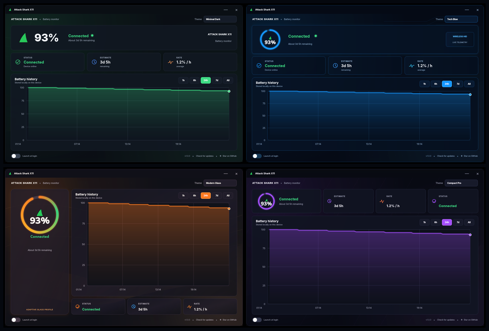
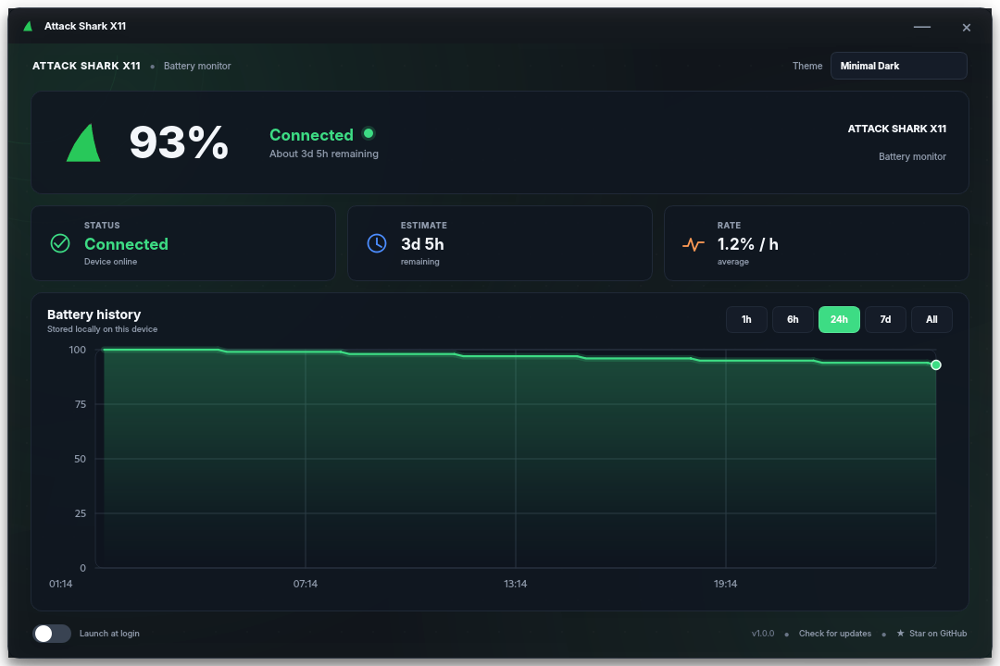
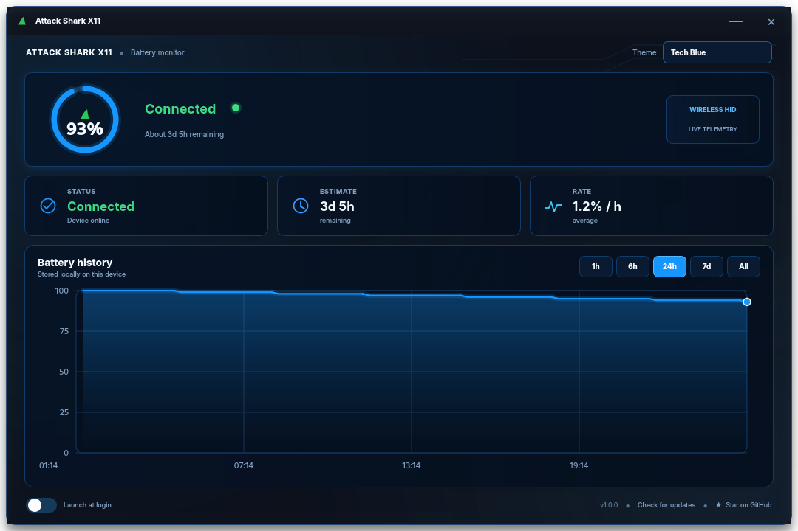
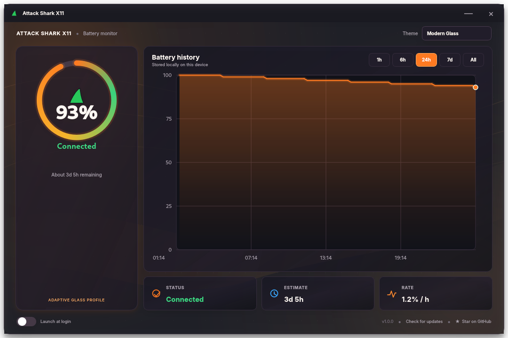
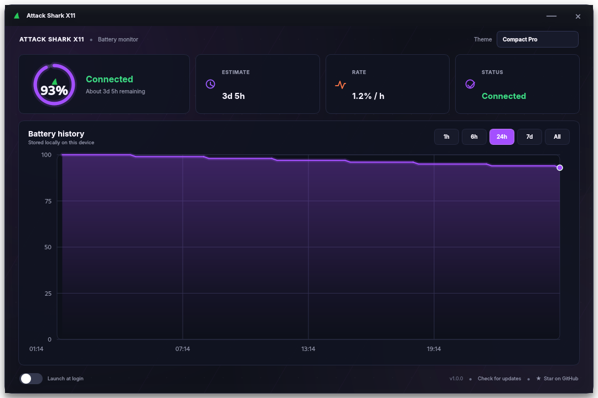

# Attack Shark X11 — Battery Tray & Dashboard

A native Windows and Linux tray application that displays the battery
level of the **Attack Shark X11** wireless mouse. It reads the native HID
reports directly and does not replace the device driver.



## Highlights

- Dynamic shark-fin icon in the system tray. Double-clicking it opens or focuses the dashboard.
- Clickable live battery entry in the tray menu; update checks are available from the dashboard footer.
- The same live icon is used in the dashboard header, window title bar, and
  taskbar window.
- Neutral **Connected** status during normal use; **Low battery** appears only
  when the configured threshold is reached.
- Animated **Loading device...** state while the first mouse status is read.
- Four fully rendered PySide6 dashboard themes: **Minimal Dark**, **Tech Blue**, **Modern Glass**, and **Compact Pro**. Each theme has its own layout, palette, antialiased gauge, and chart treatment; the choice is stored locally and restored on the next launch.
- Battery history chart with `1h`, `6h`, `24h`, `7d`, and `All` ranges.
- Estimated remaining time and battery-use rate once enough history exists.
- Desktop notifications when the battery reaches 20%, 10%, and 5%; each alert can repeat after the battery rises above that level and drains again.
- Optional launch at startup, disabled by default.
- Single-instance behavior: opening the app again brings up the existing
  dashboard instead of creating another tray icon.
- Automatic update checks through GitHub Releases.
- All history and settings remain local to the computer.

## Windows installation

Download **`AttackSharkX11-Setup-1.1.1.exe`** from the latest GitHub Release and
run it. Python is not required.

The installer:

- installs the standalone application for the current user;
- creates a Start Menu entry;
- offers a desktop shortcut, selected by default;
- offers **Launch at Windows startup**, not selected by default;
- adds a normal entry to Windows **Installed apps** for uninstallation.

The current release is unsigned. Windows SmartScreen may therefore show an
*Unknown publisher* warning until the project builds reputation or a code-signing
certificate is added.

## Using the application

The app starts in the tray. Double-click the fin icon, click the live battery
entry, or choose **Dashboard** to open the window. Closing the window returns it
to the tray; choose **Quit** from the tray menu to stop it.

Use the **Theme** selector in the upper-right corner of the dashboard to switch
between Minimal Dark, Tech Blue, Modern Glass, and Compact Pro.

When the wireless dongle is detected but the mouse has not emitted a battery
report yet, move the mouse to wake it. Over the USB cable the app can detect that
the mouse is charging, but the percentage is not available from that device ID.


## Dashboard themes

The four themes are built with PySide6/Qt and change the layout as well as the color palette while keeping the same battery data and controls. Circular gauges and charts are painted with antialiasing, so they remain sharp at Windows display scaling levels. Theme changes are applied live without restarting the app. Each profile also has a translucent atmospheric background made from layered glows, ribbons, subtle texture, and theme-specific geometry.

| Minimal Dark | Tech Blue |
| --- | --- |
|  |  |
| Modern Glass | Compact Pro |
|  |  |

## Data locations

On Windows:

```text
%LOCALAPPDATA%\AttackSharkX11\history.csv
%LOCALAPPDATA%\AttackSharkX11\settings.json
%LOCALAPPDATA%\AttackSharkX11\error.log
```

On Linux:

```text
~/.local/share/AttackSharkX11/
```

## Linux installation

The repository keeps full Linux support. From a source checkout:

```bash
./scripts/install_linux.sh
```

This creates an isolated virtual environment, installs the application, and
adds a desktop entry. Remove it with:

```bash
./scripts/uninstall_linux.sh
```

Linux requires Python 3, the platform libraries required by PySide6/Qt, and the native libraries needed by `hidapi`. On Debian or Ubuntu, install the common Qt runtime libraries before running the installer:

```bash
sudo apt install python3 python3-venv libegl1 libgl1 libxkbcommon-x11-0 libxcb-cursor0
./scripts/install_linux.sh
```

The app needs permission to read the wireless dongle's HID interface. If the dashboard says **Unavailable**, or `attack-shark-x11 --check` reports `HID access: FAILED`, install the included udev rule and reconnect the dongle:

```bash
sudo ./scripts/install_udev.sh
```

The rule grants access to the logged-in desktop session. On systems without `systemd-udevd` or logind, configure an equivalent local udev rule for USB ID `1d57:fa60` and grant access to your user. The dashboard remains usable on desktop environments without a system tray; it opens directly instead.

## Command-line tools

From a source checkout:

```bash
python asx11_battery.py --once
python asx11_battery.py --watch
python asx11_battery.py --check
python asx11_battery.py --debug
```

## Running from source

Use Python 3.12 and an isolated environment:

```powershell
py -3.12 -m venv .venv
.\.venv\Scripts\Activate.ps1
python -m pip install -r requirements-dev.txt
python -m pytest
python asx11_battery.py --debug
```

The application now uses **PySide6/Qt** for the dashboard and system tray; `pystray` and Tkinter are no longer required.

## Building the Windows installer

Requirements:

- Windows 10 or 11, 64-bit;
- Python 3.12;
- Inno Setup 6.

Run:

```powershell
./scripts/build_windows.ps1
```

The script runs the tests, bundles the PySide6/Qt runtime in an optimized PyInstaller `onedir` application,
and wraps it in one downloadable installer:

```text
dist/installer/AttackSharkX11-Setup-1.1.1.exe
```

The installed application uses multiple internal files for faster startup and
more predictable antivirus behavior, while users download only the single
installer executable.

## GitHub Actions and Releases

The repository includes two workflows:

- `test.yml` installs the complete development dependencies and tests the Qt UI and core logic on Windows and Linux with Python 3.10 and 3.12;
- `build-release.yml` uses a hosted Windows runner to test the project, bundle the application with PyInstaller, build the Inno Setup installer, and generate a SHA-256 checksum.

A manual run from **Actions → Build Windows installer → Run workflow** creates a downloadable workflow artifact. Pushing a version tag also creates or updates the matching GitHub Release and attaches the installer and checksum automatically:

```bash
git tag v1.1.1
git push origin v1.1.1
```

The published asset is:

```text
AttackSharkX11-Setup-1.1.1.exe
```

## Technical notes

Wireless reports use the signature:

```text
03 55 40 01 <battery percentage>
```

The protocol information is based on the reverse-engineering work in
[HarukaYamamoto0/attack-shark-x11-driver](https://github.com/HarukaYamamoto0/attack-shark-x11-driver).
This project is not affiliated with Attack Shark.

## License

MIT — see [LICENSE](LICENSE).
